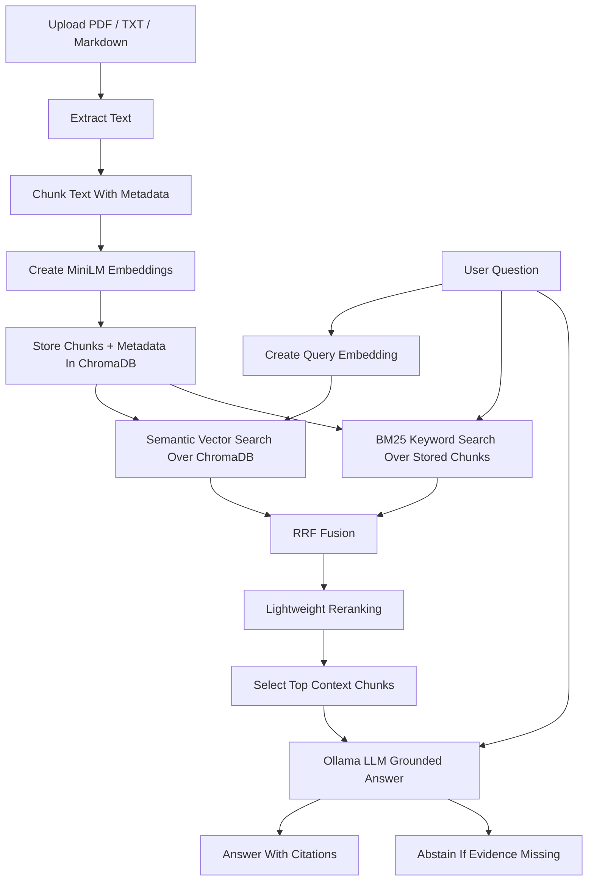

# HireKiwi RAG Knowledge Assistant

A FastAPI-based Retrieval-Augmented Generation (RAG) API that answers questions from uploaded documents with grounded citations and abstains when the answer is not present in the provided content.

The system supports PDF, TXT, and Markdown ingestion, semantic retrieval with embeddings, vector storage, LLM-based grounded answering, evidence citations, automated tests, Docker support, and evaluation questions.

## Features

- Upload PDF, TXT, and Markdown documents
- Extract text and split documents into searchable chunks
- Generate real embeddings using `sentence-transformers/all-MiniLM-L6-v2`
- Store chunk embeddings and metadata in ChromaDB
- Retrieve evidence using semantic search, BM25, RRF fusion, and lightweight reranking
- Generate answers using local Ollama models
- Return citations with source document name, page/section, chunk ID, and excerpt
- Abstain when the uploaded documents do not contain enough information
- Evaluate answerable, unanswerable, comparison, and multi-evidence questions
- Includes FastAPI backend, optional Streamlit UI, tests, and Docker setup

## Tech Stack

- Python 3.11
- FastAPI
- ChromaDB
- Sentence Transformers: `all-MiniLM-L6-v2`
- Ollama: `qwen2.5:1.5b` default, `qwen2.5:3b` optional
- SQLite / SQLAlchemy
- BM25 + vector search + RRF + reranking
- Pytest
- Docker / Docker Compose

## Architecture



Streamlit is only an optional frontend. The main deliverable is the FastAPI API.

## Setup

Create and activate a Python 3.11 environment.

```powershell
py -3.11 -m venv .venv
.\.venv\Scripts\Activate.ps1
python -m pip install --upgrade pip
python -m pip install -r requirements.txt
Copy-Item .env.example .env
```

Generate a secret key:

```powershell
python -c "import secrets; print(secrets.token_hex(32))"
```

Add the generated value to `.env` as `JWT_SECRET_KEY`.

Install and start Ollama, then pull the model:

```powershell
ollama pull qwen2.5:1.5b
```

Optional larger model:

```powershell
ollama pull qwen2.5:3b
```

Start the API:

```powershell
python -m uvicorn app.main:app --host 127.0.0.1 --port 8000
```

Open Swagger:

```text
http://localhost:8000/docs
```

Health check:

```text
http://localhost:8000/health
```

## Optional Streamlit UI

```powershell
python -m streamlit run app/ui/streamlit_app.py --server.port 8501
```

Open:

```text
http://localhost:8501
```

## API Usage

Use Swagger at:

```text
http://localhost:8000/docs
```

Main endpoints:

| Endpoint | Purpose |
|---|---|
| `GET /health` | Check API health |
| `POST /auth/signup` | Create user |
| `POST /auth/login` | Login and get token |
| `POST /documents/upload` | Upload and index document |
| `GET /documents` | List uploaded documents |
| `GET /documents/{document_id}` | Get document status/details |
| `DELETE /documents/{document_id}` | Delete document |
| `POST /chat/query` | Ask a grounded question |

Example flow:

1. Sign up or login.
2. Copy the returned access token.
3. Authorize in Swagger using the bearer token.
4. Upload a PDF/TXT/MD document.
5. Ask a question using `/chat/query`.
6. Check answer and citations.

## Evaluation

Run automated tests:

```powershell
python -m pytest -q -p no:cacheprovider
```

Run evaluation:

```powershell
python scripts/evaluate.py --output docs/evaluation-results.json
```

The evaluation covers:

- answerable questions
- unanswerable questions
- comparison questions
- multi-evidence questions
- citation validity
- abstention behavior
- retrieval precision/recall proxies
- faithfulness proxy

## Latest Verified Results

| Check | Result |
|---|---|
| Automated tests | 231 passed |
| Live evaluation | 23/23 passed |
| Citation validity | 1.0 |
| Abstention accuracy | 1.0 |
| Lexical faithfulness proxy | 0.9774 |
| Max measured latency | 44.338 seconds |
| Docker health check | `/health` returned 200 OK |

## Docker

Docker support is included through `Dockerfile`, `docker-compose.yml`, and `.dockerignore`.

Validate Docker Compose:

```powershell
docker compose config
```

Build image:

```powershell
docker build -t rag-knowledge-assistant .
```

Run backend container:

```powershell
docker run --rm -p 8000:8000 `
  -e OLLAMA_BASE_URL=http://host.docker.internal:11434 `
  rag-knowledge-assistant
```

Check health:

```powershell
curl http://localhost:8000/health
```

Docker validation was performed successfully with `/health` returning `200 OK`.

## Sample Documents

Sample documents are included in:

```text
sample_documents/
```

They are used for local testing and evaluation. Evaluators can also upload their own PDF, TXT, or Markdown files through Swagger or the optional Streamlit UI.

## Key Decisions

- Used FastAPI because the assignment requires an API-first backend.
- Used ChromaDB for persistent vector storage.
- Used `all-MiniLM-L6-v2` for real 384-dimensional local embeddings.
- Used Ollama with Qwen models to avoid dependence on paid external LLM APIs.
- Added hybrid retrieval with vector search, BM25, RRF, and reranking to improve recall and exact-term matching.
- Added citations with source excerpts so answers can be verified.
- Added abstention behavior to avoid hallucinating when evidence is missing.
- Kept Streamlit as optional; the core system is testable through FastAPI.

## Limitations

- Scanned PDFs are not supported because OCR is not enabled.
- Local CPU inference with Ollama can be slow.
- Maximum measured latency was 44.338 seconds.
- Faithfulness metrics are lexical/proxy-based and not full semantic proof.
- Very large documents may need async ingestion, batching, or background workers.

## Future Improvements

With more time, I would add a more production-level system design with stronger guardrails:

- OCR for scanned PDFs
- async ingestion queues
- role-based access control
- document-level permissions
- rate limiting
- audit logs
- observability dashboards
- streaming responses
- stronger semantic evaluation using RAGAS or LLM-as-judge
